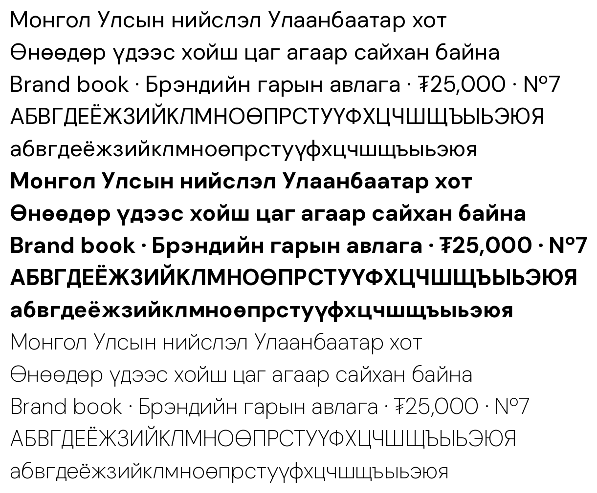

# DM Sans MN

[DM Sans](https://github.com/googlefonts/dm-fonts) with Cyrillic added, built for Mongolian.



DM Sans ships Latin only. This fork adds the full Mongolian Cyrillic alphabet (which contains the
Russian one), keeps everything else from upstream, and renames the family so it never collides with
an installed DM Sans.

- **Scripts:** Latin as upstream, plus Cyrillic `А–Я а–я Ё ё Ө ө Ү ү`
- **Also added:** `₮` (tugrik) and `№`
- **Axes:** weight 100–1000 and optical size 9–40, upright and italic, same as upstream
- **Stylistic sets:** `ss02` (single-storey a) and `ss05` (alternate y) also switch Cyrillic `а` and `у`

Not covered: Kazakh, Ukrainian, Serbian and other Cyrillic alphabets that need letters beyond these.

## Fonts

| Folder | What |
|---|---|
| `fonts/variable` | Variable TTF, upright and italic |
| `fonts/webfonts` | The same two variable fonts as WOFF2 |
| `fonts/ttf` | Static TTF instances |

```css
@font-face {
  font-family: "DM Sans MN";
  src: url("DMSansMN[opsz,wght].woff2") format("woff2");
  font-weight: 100 1000;
  font-style: normal;
}
@font-face {
  font-family: "DM Sans MN";
  src: url("DMSansMN-Italic[opsz,wght].woff2") format("woff2");
  font-weight: 100 1000;
  font-style: italic;
}
```

## How the Cyrillic is made

Nothing is drawn by hand in a font editor. `build/recipes.py` holds one recipe per letter; each recipe
measures a master's Latin (stem and bar weights, counters, curve weights, side bearings) and builds
the Cyrillic letter from those measurements, reusing Latin outlines wherever the shape exists:

- `А В Е К М Н О Р С Т Х Ү` and their lowercase partners are components of the Latin letters.
- `И Я Э Ь Ж У З` are Latin outlines mirrored, flipped or joined (`N`, `R`, `C`, `P`, `K`, `y`, `3`).
- Lowercase forms such as `в з ь я` are the capitals rescaled with their stroke weights held fixed.
- The rest (`Г Д Л П Ц Ч Ш Щ б ф ү` and friends) are built from the measured stems, bars and curves.

The recipes run once per master, so the new letters follow the weight and optical-size axes like the
Latin does. Italic Cyrillic is the upright drawing slanted the way upstream slanted its Latin.

## Build

Needs [uv](https://docs.astral.sh/uv/) and git.

```sh
./build.sh          # sources, variable fonts, static fonts, web fonts
./build.sh quick    # sources and variable fonts only
```

The script fetches upstream DM Sans at a pinned commit, writes `sources/*.glyphs`, and builds with
`gftools builder`. To change the family name, edit `FAMILY` in `build/gen.py`.

`tools/show.py` renders glyphs straight from a source and `tools/specimen.py` sets text with the
built fonts; both are handy when adjusting a recipe.

## Known limits

- The letterforms are generated and reviewed on screen, not tuned by a type designer.
- Italic Cyrillic is a slanted upright, without the optical corrections upstream gave its Latin.
- Cyrillic kerning is inherited from Latin letters with the same edge shapes; no pairs were added.

## Licence

SIL Open Font License 1.1, the same as DM Sans. See [OFL.txt](OFL.txt).

DM Sans is by Colophon Foundry and Jonny Pinhorn, based on Poppins by Indian Type Foundry.
Cyrillic extension by L'Atelier Gege LLC ([gege-mn](https://github.com/gege-mn)); see [AUTHORS.txt](AUTHORS.txt).
